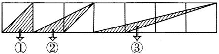

# Mathematics (Grade 6)

**ID**: 19a1ffd2
**难度**: medium
**题型**: multiple_choice

## 题目
图形是由7个正方形拼成的，①②③三个三角形的面积相比，结果是(  )

A．①＞②＞③
B．①=②=③
C．①＜②＜③

## 解答

**答案**: B

1. Step1:明确三角形面积公式为底×高÷2
2. Step2:观察图形可知①②③三个三角形的底都等于正方形的边长
3. Step3:观察图形可知①②③三个三角形的高都等于正方形的边长
4. Step4:因为三个三角形的底和高都相等，根据三角形面积公式可得它们的面积相等
5. Step5:所以答案选B

## 知识点

**知识点**:
  - 面积及面积的大小比较．

---
