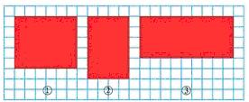

# Mathematics (Grade 6)

**ID**: 1ab57a8f
**难度**: medium
**题型**: multiple_choice

## 题目
如图（  ）面红旗长与宽的比是3：2．
A．①
B．②
C．③

## 解答

**答案**: B

1. Step1:假设每个小正方形的边长为1厘米
2. Step2:计算①红旗的长为6厘米，宽为5厘米，得出长与宽的比为6：5
3. Step3:计算②红旗的长为6厘米，宽为4厘米，得出长与宽的比为6：4，化简后为3：2
4. Step4:计算③红旗的长为9厘米，宽为4厘米，得出长与宽的比为9：4
5. Step5:对比三个红旗长与宽的比，发现②红旗长与宽的比是3：2，所以答案选B

## 知识点

**知识点**:
  - 比的意义；长方形的特征及性质．

---
