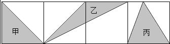

# Mathematics (Grade 6)

**ID**: 1ac30fbd
**难度**: medium
**题型**: multiple_choice

## 题目
如图中有四个大小相等的正方形．比较图中三个三角形的面积大小，结果是（  ）

A．甲=乙=丙
B．甲＞乙＞丙
C．乙＞甲＞丙
D．丙＞乙＞甲

## 解答

**答案**: A

1. Step1:分析甲三角形，其底和高均为正方形的边长，根据三角形面积公式可得其面积为边长×边长÷2，即甲的面积是正方形面积的一半
2. Step2:分析乙三角形，其底和高同样均为正方形的边长，由三角形面积公式可知其面积为边长×边长÷2，即乙的面积是正方形面积的一半
3. Step3:分析丙三角形，其底和高还是均为正方形的边长，根据三角形面积公式得出其面积为边长×边长÷2，即丙的面积是正方形面积的一半
4. Step4:因为甲、乙、丙的面积都为正方形面积的一半，所以甲乙丙的面积都相等，答案选A

## 知识点

**知识点**:
  - 面积及面积的大小比较．

---
