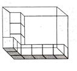

# Mathematics (Grade 6)

**ID**: 1ef5a75e
**难度**: medium
**题型**: multiple_choice

## 题目
如图，一个长方体玻璃容器中，摆了若干个体积为1立方厘米的正方体。这个玻璃容器的容积是（   ）立方厘米。

A．45
B．30
C．60
D．40

## 解答

**答案**: C

1. Step1:观察图形可知，长方体玻璃容器底层横向摆了5个体积为1立方厘米的正方体，所以底层横向长度为5厘米
2. Step2:底层纵向摆了3个体积为1立方厘米的正方体，所以底层纵向长度为3厘米
3. Step3:容器一共摆了4层这样的正方体，所以高度为4厘米
4. Step4:根据长方体容积公式V = 长×宽×高，可得容积为5×3×4 = 60立方厘米
5. Step5:对比选项，答案为C

## 知识点

**知识点**:
  - 小学数学;图形与几何

---
