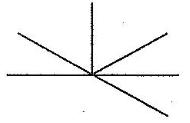

# Mathematics (Grade 6)

**ID**: 1f2960d3
**难度**: medium
**题型**: multiple_choice

## 题目
图中，有（    ）个锐角．
 ① 5
 ② 6
 ③ 9

## 解答

**答案**: B

1. Step1:明确锐角的定义为小于90°的角
2. Step2:根据角由公共端点的两条射线组成这一概念，在图中开始计数锐角
3. Step3:逐一计数图中的锐角，得出共有6个
4. Step4:将结果与选项对比，发现选项②对应的是6，所以答案为②，即['B']

## 知识点

**知识点**:
  - 第八单元测试卷（A)-第八单元测试卷（A)
-

---
