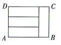

# Mathematics (Grade 6)

**ID**: 21f7d262
**难度**: medium
**题型**: multiple_choice

## 题目
如图，四个同样的小长方形拼成一个大长方形ABCD，那么AB与BC的比是（   ）。

A．1：1
B．3：2
C．4：3
D．3：4

## 解答

**答案**: C

1. Step1:设小长方形的长为a，宽为b。由图可知大长方形的长AB = 3b，宽BC = a，且a = 2b。
2. Step2:将a = 2b代入AB与BC的比中，即AB:BC = 3b:a = 3b:2b。
3. Step3:化简3b:2b，得到AB与BC的比为3:2，所以答案选B

## 知识点

**知识点**:
  - 小学数学;数与代数;比和比例;比;比的应用

---
