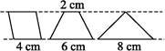

# Mathematics (Grade 6)

**ID**: 24398931
**难度**: medium
**题型**: multiple_choice

## 题目
比较下图平行线间三个图形的面积,说法正确的是($\textit{}$

A．平行四边形面积最大
B．梯形面积最大
C．3个图形面积相等

## 解答

**答案**: C

1. Step1:设平行线间的距离为h，平行四边形面积公式为S = 底×高，其底为4cm，高为h，则平行四边形面积S1 = 4h；
2. Step2:梯形面积公式为S=(上底 + 下底)×高÷2，上底为2cm，下底为6cm，高为h，则梯形面积S2=(2 + 6)×h÷2 = 4h；
3. Step3:三角形面积公式为S = 底×高÷2，底为8cm，高为h，则三角形面积S3 = 8h÷2 = 4h；
4. Step4:比较S1、S2、S3，可得S1 = S2 = S3，即3个图形面积相等，所以答案选C。

## 知识点

**知识点**:
  - 小学数学;图形与几何;平面图形;平行四边形;平行四边形的面积;梯形的特征及分类;梯形的面积;三角形;三角形的面积

---
