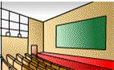

# Mathematics (Grade 6)

**ID**: 271b2dc7
**难度**: medium
**题型**: multiple_choice

## 题目
通过这幅图．我们可以得出，观察者的位置？(  )
A．教室外
B．教室内
C．天空中

## 解答

**答案**: B

1. Step1:观察图片内容，看到的是教室的前半部分，包括黑板、部分桌椅等
2. Step2:结合解析2，因为看到的是教室的前半部分，所以判断观察者的位置在教室内
3. Step3:对比选项，A选项教室外不能看到这样的教室前半部分场景，C选项天空中视角与图中不符，只有B选项教室内符合观察情况，所以答案选B

## 知识点

**知识点**:
  - 从不同方向观察物体和几何体．

---
