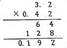

# Mathematics (Grade 6)

**ID**: 278a145d
**难度**: medium
**题型**: multiple_choice

## 题目
下图竖式计算错误的原因是（   ）。

$\begin{description}
\item A．积的小数位数不正确\item B．因数的小数点没有对齐\item C．计算过程中数位书写不正确
\end{description}$

## 解答

**答案**: C

1. Step1:观察竖式计算过程，发现计算过程中数位书写不正确，比如在计算乘法时，数位的对应位置存在错误
2. Step2:分析选项A，积的小数位数是正确的，通过因数中小数位数相加可判断积的小数位数情况，所以A选项不符合错误原因
3. Step3:分析选项B，小数乘法中因数的小数点不需要对齐，所以B选项也不符合错误原因
4. Step4:确定该竖式计算错误的原因是计算过程中数位书写不正确，即选项C

## 知识点

**知识点**:
  - 小学数学;数与代数;数的运算;小数的四则运算;小数的乘法

---
