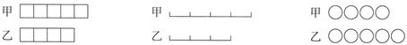

# Mathematics (Grade 6)

**ID**: 2c647c24
**难度**: medium
**题型**: multiple_choice

## 题目
下面是3位同学用自己所画的图来表示“甲比乙多25%”，有(    )位同学的理解是正确的。

$\begin{description}
\item A．0\item B．1\item C．2\item D．3
\end{description}$

## 解答

**答案**: A

1. Step1:分析第一个图，设甲和乙每个小格代表的量相同，甲有5个小格，乙有4个小格，计算甲比乙多的比例为(5 - 4)÷4 = 25%，此图理解正确
2. Step2:分析第二个图，设每小段长度代表的量相同，甲有4小段，乙有3小段，计算甲比乙多的比例为(4 - 3)÷3≈33.3%≠25%，此图理解错误
3. Step3:分析第三个图，设每个圆圈代表的量相同，甲有4个圆圈，乙有5个圆圈，甲比乙少，不是甲比乙多25%，此图理解错误
4. Step4:统计理解正确的图的数量为1个

## 知识点

**知识点**:
  - 小学数学;数与代数;数的运算;百分数的四则运算

---
