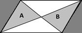

# Mathematics (Grade 6)

**ID**: 2fb6d90f
**难度**: medium
**题型**: multiple_choice

## 题目
如图：从阴影三角形A到B的运动是（   ）

A．平移
B．旋转
C．不确定

## 解答

**答案**: B

1. Step1:观察图形中阴影三角形A和B的位置关系
2. Step2:发现阴影三角形A绕着两条对角线的交点旋转180度可得到三角形B
3. Step3:根据旋转的定义，确定从阴影三角形A到B的运动是旋转
4. Step4:对比选项，选择答案B

## 知识点

**知识点**:
  - 

---
