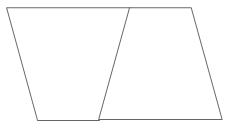

# Mathematics (Grade 6)

**ID**: 309338b3
**难度**: medium
**题型**: multiple_choice

## 题目
两个完全一样的梯形可以拼成一个平行四边形，这个平行四边形的底等于（      ）．

A．梯形的高
B．梯形的上底
C．梯形上底与下底之和

## 解答

**答案**: C

1. Step1:明确题目是在问两个完全一样的梯形拼成平行四边形后，平行四边形的底与梯形各部分的关系
2. Step2:回忆两个完全一样的梯形拼接方式，是将一个梯形的上底与另一个梯形的下底拼接在一起
3. Step3:由此可知拼成的平行四边形的底就是梯形的上底与下底之和
4. Step4:对比选项，发现C选项为梯形上底与下底之和，所以答案是C

## 知识点

**知识点**:
  - 小学数学;图形与几何;平面图形;平行四边形;平行四边形的概念及特点;梯形的特征及分类

---
