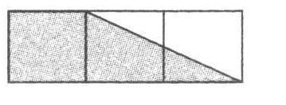

# Mathematics (Grade 6)

**ID**: 329c2845
**难度**: medium
**题型**: multiple_choice

## 题目
如图，阴影部分的面积与空白部分的面积比较（   ）

 A．阴影部分的面积是空白部分面积的2倍
 B．阴影部分的面积是空白部分面积的3倍
 C．无法确定它们之间的倍数关系

## 解答

**答案**: B

1. Step1:观察图形，发现中间正方形上面的小三角形和右边正方形下面的小三角形大小一样
2. Step2:根据上述发现可知，阴影部分可看作是两个正方形的面积
3. Step3:同时可知空白部分是一个正方形的面积
4. Step4:计算阴影部分面积与空白部分面积的倍数关系，2÷1 = 2，这里错误，应该是阴影部分面积是3个正方形小格（两个完整正方形加两个可拼成一个正方形的三角形），空白部分是1个正方形小格，3÷1=3
5. Step5:得出结论，阴影部分的面积是空白部分面积的3倍，答案选B

## 知识点

**知识点**:
  - --

---
