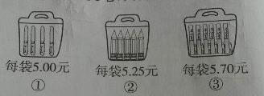

# Mathematics (Grade 6)

**ID**: 355237e1
**难度**: medium
**题型**: multiple_choice

## 题目
如果只买一支笔，买哪种便宜？

 5.00元     5.25元     5.70元  ①   ②   ③

## 解答

**答案**: ①

1. Step1:明确需要比较三种笔的单价5.00元、5.25元、5.70元的大小
2. Step2:根据小数大小比较方法，得出5.00元＜5.25元＜5.70元
3. Step3:确定单价最小的5.00元对应的是①，所以①最便宜

## 知识点

**知识点**:
  - --

---
