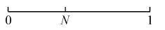

# Mathematics (Grade 6)

**ID**: 3569c5bf
**难度**: medium
**题型**: multiple_choice

## 题目
（）算式的得数与N最接近。 

A.0.3÷0.6
B.2.5÷5.8
C.0.3－0.2
D.0.25×6

## 解答

**答案**: B

1. Step1:分析题意可知，N的范围是大于0且小于1，N比0.5小且靠近0.5
2. Step2:计算选项A，0.3÷0.6 = 0.5
3. Step3:计算选项B，2.5÷5.8≈0.431
4. Step4:计算选项C，0.3－0.2 = 0.1
5. Step5:计算选项D，0.25×6 = 1.5
6. Step6:比较大小得到0.1＜0.431＜0.5＜1.5，结合0＜N＜0.5且N靠近0.5，得出2.5÷5.8的得数与N最接近，答案为B

## 知识点

**知识点**:
  - 

---
