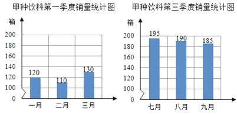

# Mathematics (Grade 6)

**ID**: 35cc4b67
**难度**: medium
**题型**: multiple_choice

## 题目
下面是某超市第一、三季度的饮料销售统计图，（    ）季度的月平均销售量多。 

A．一季度
B．三季度

## 解答

**答案**: B

1. Step1:计算第一季度的总销售量，120 + 110 + 130 = 360箱
2. Step2:计算第一季度的月平均销售量，360÷3 = 120箱
3. Step3:计算第三季度的总销售量，195 + 190 + 185 = 570箱
4. Step4:计算第三季度的月平均销售量，570÷3 = 190箱
5. Step5:比较两个季度的月平均销售量，190＞120，得出第三季度月平均销售量多，答案选B

## 知识点

**知识点**:
  - 小学数学;统计和概率;统计;统计图;简单条形统计图

---
