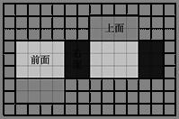

# Mathematics (Grade 6)

**ID**: 36dcb826
**难度**: medium
**题型**: multiple_choice

## 题目
下图是一个长方体的表面展开图（每个小方格的边长表示1厘米）．这个长方体的表面积是（ ）平方厘米，体积是（ ）立方厘米．

$\begin{description}
\item A．52、24\item B．52、18\item C．40、24\item D．40、18
\end{description}$

## 解答

**答案**: A

1. Step1:根据长方体展开图，可知长方体的长是4厘米，宽是3厘米，高是2厘米。
2. Step2:根据长方体表面积公式S=(ab + ah + bh)×2（其中a为长，b为宽，h为高），可得表面积为(4×3 + 4×2 + 3×2)×2=(12 + 8 + 6)×2=26×2 = 52平方厘米。
3. Step3:根据长方体体积公式V = abh，可得体积为4×3×2 = 24立方厘米。
4. Step4:对比选项，可知答案为A。

## 知识点

**知识点**:
  - 小学数学;图形与几何

---
