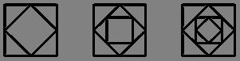

# Mathematics (Grade 6)

**ID**: 37b387bd
**难度**: medium
**题型**: multiple_choice

## 题目
观察下列图形，则第n个图形中三角形的个数是(     )。

第1个          第2个         第3个
$\begin{description}
\item A．2n\item B．2n+2\item C．4n\item D．4n+4
\end{description}$

## 解答

**答案**: B

1. Step1:观察第1个图形，里面有4个三角形；
2. Step2:观察第2个图形，里面有8个三角形；
3. Step3:观察第3个图形，里面有12个三角形；
4. Step4:分析数量规律，4 = 4×1，8 = 4×2，12 = 4×3，可得出第n个图形中三角形的个数是4n；
5. Step5:将4n与选项对比，发现没有完全匹配的，进一步分析，第1个图形也可看作4 + 0×2，第2个图形可看作4 + 2×2，第3个图形可看作4 + 4×2，由此可推出第n个图形中三角形个数的表达式为4 + (2n - 2)×2，化简后为2n + 2，与选项B一致。

## 知识点

**知识点**:
  - 小学数学;探索规律;图形的变化规律

---
