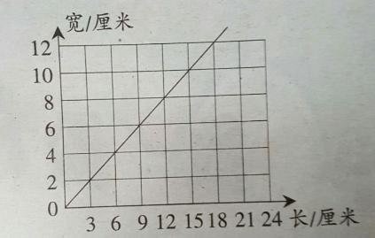

# Mathematics (Grade 6)

**ID**: 3f6ba633
**难度**: medium
**题型**: multiple_choice

## 题目
下面图像表示的是哪种况下长方形长与宽的关系？（  ）。

 A．长一定的长方形
 B．形状一定的长方形
 C．周长一定的长方形
 D．面积一定的长方形

## 解答

**答案**: D

1. Step1:观察图像，判断长和宽的变化关系，发现随着长的增大宽也增大，长和宽成正比例关系。
2. Step2:分析选项A，长一定时，宽变化，长和宽不是正比例关系，不符合图像。
3. Step3:分析选项B，形状一定即长和宽的比值一定，符合长和宽成正比例关系，该选项有可能正确。
4. Step4:分析选项C，周长一定时，长和宽的和一定，长和宽不是正比例关系，不符合图像。
5. Step5:分析选项D，面积一定时，长和宽成反比例关系，不符合图像。
6. Step6:综上，选择B选项。

## 知识点

**知识点**:
  - 

---
