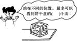

# Mathematics (Grade 6)

**ID**: 3ff7d917
**难度**: medium
**题型**: multiple_choice

## 题目
站在不同的位置最多可以看到饼干盒的几个面？（    ）

$\begin{description}
\item A．2\item B．5\item C．3
\end{description}$

## 解答

**答案**: C

1. Step1:明确问题是求站在不同位置最多能看到饼干盒的面数
2. Step2:根据生活常识和空间认知，一个立体的饼干盒，从不同位置观察，最多能看到3个面
3. Step3:对比选项，A选项2个面不是最多，B选项5个面不符合实际，C选项3个面符合最多能看到的面数情况，所以答案是C

## 知识点

**知识点**:
  - 

---
