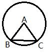

# Mathematics (Grade 6)

**ID**: 40aed86f
**难度**: medium
**题型**: multiple_choice

## 题目
如下图所示，以点A为圆心的圆内，只要运用圆的（      ）特征，就可以证明三角形ABC为等腰三角形。

$\begin{description}
\item A．同一个圆的半径相等\item B．圆的周长是直径的兀倍\item C．同一个圆的直径的长度是半径的2倍\item D．圆内最长的线段是直径
\end{description}$

## 解答

**答案**: A

1. Step1:因为三角形ABC在以点A为圆心的圆内，AB和AC都是圆的半径。
2. Step2:根据圆的特征，同一个圆的半径相等，所以AB = AC。
3. Step3:根据等腰三角形的定义，有两条边相等的三角形是等腰三角形，由于AB = AC，所以三角形ABC为等腰三角形。
4. Step4:逐一分析选项，选项A同一个圆的半径相等符合证明三角形ABC为等腰三角形所运用的圆的特征，选项B圆的周长是直径的π倍、选项C同一个圆的直径的长度是半径的2倍、选项D圆内最长的线段是直径均与证明三角形ABC为等腰三角形无关，所以答案是A。

## 知识点

**知识点**:
  - 小学数学;图形与几何;平面图形;圆;圆的概念及特点

---
