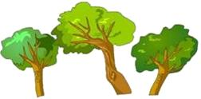

# Mathematics (Grade 6)

**ID**: 40c5001a
**难度**: medium
**题型**: multiple_choice

## 题目
图中有（  ）棵大树。

A．1
B．2
C．3
D．4

## 解答

**答案**: C

1. Step1:观察图片，对其中大树的数量进行计数
2. Step2:得出图片中大树的数量为3棵
3. Step3:对比选项，找到对应数量的选项为C

## 知识点

**知识点**:
  - 小学数学;数与代数;数的认识;整数的认识

---
