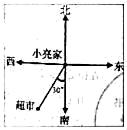

# Mathematics (Grade 6)

**ID**: 424808bc
**难度**: medium
**题型**: multiple_choice

## 题目
超市在小亮家的（  ）方向上

A．南偏西30°
B．北偏西30°
C．东偏北30°
D．西偏南30°

## 解答

**答案**: A

1. Step1:根据方向的表示规则，先确定以小亮家为观测点。
2. Step2:观察图中超市相对于小亮家的位置，超市在小亮家的左下方，也就是西和南之间的方向。
3. Step3:由图中标注的角度可知，超市与小亮家连线和正南方向夹角为30°，所以超市在小亮家南偏西30°方向。
4. Step4:对比选项，发现A选项南偏西30°符合超市相对于小亮家的方向。

## 知识点

**知识点**:
  - 小学数学;图形与几何;位置与方向;方向

---
