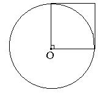

# Mathematics (Grade 6)

**ID**: 446e7893
**难度**: medium
**题型**: multiple_choice

## 题目
下图中以圆的半径为边长的正方形的面积是20平方厘米，圆的面积是（   ）

A．26.8平方厘米
B．62.8平方厘米
C．68.2平方厘米
D．86.2平方厘米

## 解答

**答案**: B

1. Step1:已知以圆的半径为边长的正方形面积是20平方厘米，根据正方形面积公式S = a²（这里a为边长，也就是圆的半径r），可得r² = 20平方厘米。
2. Step2:根据圆的面积公式S = πr²，π取3.14，将r² = 20代入可得圆的面积S = 3.14×20 = 62.8平方厘米。
3. Step3:对比选项，答案是B。

## 知识点

**知识点**:
  - 小学数学;图形与几何;平面图形;圆;圆的面积

---
