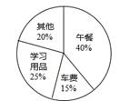

# Mathematics (Grade 6)

**ID**: 44747fcf
**难度**: medium
**题型**: multiple_choice

## 题目
小红同学将自己5月份的各项消费情况制成扇形统计图，从图中可以看出（  ）。

$\begin{description}
\item A．各项消费金额的增减变化情况\item B．各项消费的金额\item C．消费的总金额\item D．各项消费占消费总金额的百分比
\end{description}$

## 解答

**答案**: D

1. Step1:明确扇形统计图的特点，它是用整个圆表示总数，用圆内各个扇形的大小表示各部分数量占总数的百分数。
2. Step2:分析选项A，扇形统计图不能体现各项消费金额的增减变化情况，所以A错误。
3. Step3:分析选项B，扇形统计图不能直接得出各项消费的具体金额，所以B错误。
4. Step4:分析选项C，扇形统计图无法直接知道消费的总金额，所以C错误。
5. Step5:得出结论，扇形统计图能清楚地表示出各项消费占消费总金额的百分比，所以D正确。

## 知识点

**知识点**:
  - 小学数学;统计和概率;统计;统计图;扇形统计图的特点及绘制

---
