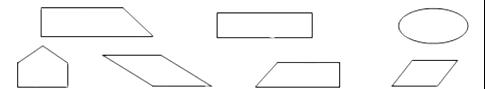

# Mathematics (Grade 6)

**ID**: 4607a9d2
**难度**: medium
**题型**: multiple_choice

## 题目
下面图形中平行四边形共有（  ）个。

$\begin{description}
\item A．3\item B．4\item C．5\item D．6
\end{description}$

## 解答

**答案**: A

1. Step1:明确平行四边形的定义为两组对边分别平行的四边形
2. Step2:观察给出的图形，逐一判断是否符合平行四边形的定义
3. Step3:数出符合平行四边形定义的图形个数为3个
4. Step4:对比选项，发现选项A符合

## 知识点

**知识点**:
  - 

---
