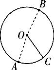

# Mathematics (Grade 6)

**ID**: 46f79188
**难度**: medium
**题型**: multiple_choice

## 题目
如图，张亮从A点经过()点到8点上班，徐伟从C点经过O点也到B点上班，他俩上班的路程(    )。

A．张亮远些
B．徐伟远些
C．一样远
D．无法比较

## 解答

**答案**: C

1. Step1:张亮从A点经过O点到B点，其路程为AO + OB，因为AO和OB都是圆的半径，所以路程为2倍半径。
2. Step2:徐伟从C点经过O点到B点，其路程为CO + OB，CO和OB也都是圆的半径，所以路程也为2倍半径。
3. Step3:由于两人的路程都为圆的2倍半径，所以他俩上班的路程一样远，答案选C。

## 知识点

**知识点**:
  - 小学数学;图形与几何;平面图形;圆;圆的概念及特点

---
