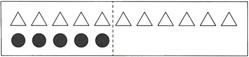

# Mathematics (Grade 6)

**ID**: 47e7ef2d
**难度**: medium
**题型**: multiple_choice

## 题目
观察下图，算式11－5表示的是（   ）。

A．●的个数
B．●比△多的个数
C．●比△少的个数

## 解答

**答案**: C

1. Step1:观察图片可知，图中有5个●，11个△。
2. Step2:算式11 - 5中，11是△的个数，5是●的个数。
3. Step3:11 - 5表示的是△比●多的个数，也就是●比△少的个数。
4. Step4:对比选项，可知答案是C。

## 知识点

**知识点**:
  - 小学数学;数与代数;数的运算;整数的四则运算;退位减法

---
