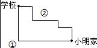

# Mathematics (Grade 6)

**ID**: 48af302a
**难度**: medium
**题型**: multiple_choice

## 题目
小明从家到学校有两条路可走，这两条路相比（     ）

$\begin{description}
\item A．①近\item B．②近\item C．一样近
\end{description}$

## 解答

**答案**: C

1. Step1:将路线②的横向线段向下平移，纵向线段向左平移
2. Step2:平移后路线②可转化为与路线①组成一个长方形的长和宽
3. Step3:路线①的长度是长方形长与宽的和
4. Step4:路线②经过平移后其长度同样是长方形长与宽的和
5. Step5:所以两条路一样近，答案选C

## 知识点

**知识点**:
  - 

---
