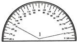

# Mathematics (Grade 6)

**ID**: 49624b1f
**难度**: medium
**题型**: multiple_choice

## 题目
图中角1的度数是（  ）

$\begin{description}
\item A．30°\item B．140°\item C．150°
\end{description}$

## 解答

**答案**: B

1. Step1:明确平角的度数为180°
2. Step2:观察图可知左边刻度对应的度数为30°
3. Step3:观察图可知右边刻度对应的度数为10°
4. Step4:根据解析2，用平角的度数减去左边的刻度再减去右边的刻度，即180° - 30° - 10°
5. Step5:计算180° - 30° - 10°的结果为140°
6. Step6:对比选项，发现140°对应的是选项B

## 知识点

**知识点**:
  - 角的度量．

---
