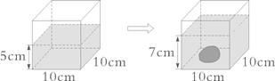

# Mathematics (Grade 6)

**ID**: 497401c4
**难度**: medium
**题型**: multiple_choice

## 题目
看下图，石头的体积是（    ）．

$\begin{description}
\item A．350cm^{3}\item B．500cm^{3}\item C．700cm^{3}\item D．200cm^{3}
\end{description}$

## 解答

**答案**: D

1. Step1:明确石头的体积等于放入石头后水上升的体积。
2. Step2:计算容器的底面积，根据长方形面积公式S = a×b（a、b分别为长和宽），这里长10cm，宽10cm，所以底面积为10×10 = 100cm²。
3. Step3:计算水上升的高度，7 - 5 = 2cm。
4. Step4:根据长方体体积公式V = S×h（S为底面积，h为高），可得石头体积为100×2 = 200cm³，所以答案选D。

## 知识点

**知识点**:
  - 小学数学;图形与几何;立体图形;不规则物体的体积算法

---
