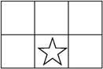

# Mathematics (Grade 6)

**ID**: 4a7f5491
**难度**: medium
**题型**: multiple_choice

## 题目
数一数,包含☆的正方形有 (  )

A．1个
B．2个
C．3个
D．4个

## 解答

**答案**: C

1. Step1:观察图形，找到包含☆的最小正方形，发现只有1个小正方形包含☆
2. Step2:接着考虑由4个小正方形组成的大正方形，发现有2个这样的大正方形包含☆
3. Step3:将包含☆的小正方形和大正方形的数量相加，1 + 2 = 3个
4. Step4:对比选项，发现选项C符合数量为3个的结果

## 知识点

**知识点**:
  - 小学数学;探索规律;图形的变化规律

---
