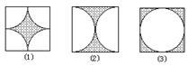

# Mathematics (Grade 6)

**ID**: 4acf182e
**难度**: medium
**题型**: multiple_choice

## 题目
下面三幅图的阴影部分的周长相比较，（     ）。 

$\begin{description}
\item A．图(1)大\item B．图(2)大\item C．图(3)大\item D．同样大
\end{description}$

## 解答

**答案**: C

1. Step1:观察图(1)，其阴影部分的周长是由圆的周长组成
2. Step2:观察图(2)，其阴影部分的周长同样是由圆的周长组成
3. Step3:观察图(3)，其阴影部分的周长还是由圆的周长组成
4. Step4:由于三个图中的圆的直径相同，根据圆的周长公式C = πd（d为直径），可知三个图中阴影部分的周长相等，所以答案选D

## 知识点

**知识点**:
  - 小学数学;图形与几何;平面图形;组合图形的周长

---
