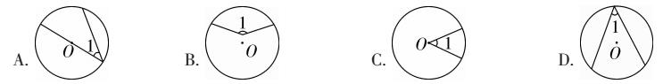

# Mathematics (Grade 6)

**ID**: 4b5b1fb0
**难度**: medium
**题型**: multiple_choice

## 题目
下面以O为圆心的各圆中，图（）中的∠1是圆心角。

## 解答

**答案**: C

1. Step1:明确圆心角的定义为顶点在圆心上的角叫做圆心角
2. Step2:分析选项A，∠1的顶点不在圆心O上，不是圆心角
3. Step3:分析选项B，∠1的顶点不在圆心O上，不是圆心角
4. Step4:分析选项C，∠1的顶点在圆心O上，是圆心角
5. Step5:分析选项D，∠1的顶点不在圆心O上，不是圆心角
6. Step6:综上，答案是C

## 知识点

**知识点**:
  - 圆的认识

---
