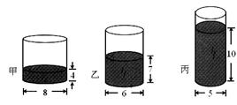

# Mathematics (Grade 6)

**ID**: 4d8bf4d2
**难度**: medium
**题型**: multiple_choice

## 题目
下面（  ）杯中的饮料最多（单位：厘米）。

A．甲
B．乙
C．丙

## 解答

**答案**: A

1. Step1:根据圆柱体积公式V = πr²h，分别计算三杯饮料体积。对于甲杯，底面半径为8÷2 = 4厘米，饮料高度为圆柱高度的1/4，假设圆柱高度为h，则甲杯饮料体积V甲 = π×4²×(h×1/4)= 4πh。
2. Step2:对于乙杯，底面半径为6÷2 = 3厘米，饮料高度为圆柱高度的1/2，假设圆柱高度为h，则乙杯饮料体积V乙 = π×3²×(h×1/2)= 4.5πh。
3. Step3:对于丙杯，底面半径为5÷2 = 2.5厘米，饮料高度为10厘米，假设圆柱高度为h，这里h = 10，则丙杯饮料体积V丙 = π×2.5²×10 = 62.5π。
4. Step4:比较三杯饮料体积大小，因为h为正数，所以4πh＜4.5πh，又因为4.5πh＜62.5π，所以丙杯饮料体积最大。
5. Step5:所以答案选C。

## 知识点

**知识点**:
  - 

---
