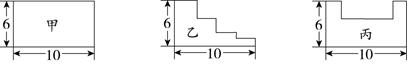

# Mathematics (Grade 6)

**ID**: 4edf3653
**难度**: medium
**题型**: multiple_choice

## 题目
如图，甲、乙、丙三个图形的周长相比，(  )。(单位：厘米)

A．甲的周长长
B．乙的周长长
C．丙的周长长
D．无法比较

## 解答

**答案**: C

1. Step1:将乙图形通过平移转化，其水平方向线段长度之和为10厘米，竖直方向线段长度之和为6厘米，所以乙图形的周长为(10 + 6)×2 = 32厘米
2. Step2:将丙图形通过平移转化，其水平方向线段长度之和为10厘米，竖直方向线段长度除了6厘米外，还有多出来的部分，所以丙图形的周长大于(10 + 6)×2 = 32厘米
3. Step3:甲图形是长方形，其周长为(10 + 6)×2 = 32厘米
4. Step4:比较甲、乙、丙三个图形的周长，甲和乙周长都为32厘米，丙的周长大于32厘米，所以丙的周长长，答案选C

## 知识点

**知识点**:
  - 

---
