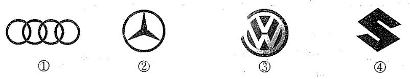

# Mathematics (Grade 6)

**ID**: 508d0b0c
**难度**: medium
**题型**: multiple_choice

## 题目
下面的图形是几种汽车的标志，其中图形（  ）是由单位图形平移得到的．

## 解答

**答案**: ①

1. Step1:明确平移的性质为图形的形状和大小都不改变，只有位置改变
2. Step2:观察图形①，发现它是由一个圆通过平移得到的
3. Step3:观察图形②，其是由特定的三叉星形状构成，不是由单位图形平移得到
4. Step4:观察图形③，它是由特定的字母组合形状构成，不是由单位图形平移得到
5. Step5:观察图形④，它是由特定的不规则形状构成，不是由单位图形平移得到
6. Step6:综上，只有图形①是由单位图形平移得到的，所以答案是①

## 知识点

**知识点**:
  - 第5单元检测卷;

---
