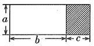

# Mathematics (Grade 6)

**ID**: 50d1f016
**难度**: medium
**题型**: multiple_choice

## 题目
如图所示，阴影部分的面积可以表示为（   ）。

$\begin{description}
\item A．ac\item B．a（b＋c）\item C．ab
\end{description}$

## 解答

**答案**: A

1. Step1:观察图形可知，阴影部分是一个长方形
2. Step2:该长方形的长为c，宽为a
3. Step3:根据长方形面积公式S = 长×宽，可得阴影部分面积S = ac
4. Step4:对比选项，只有A选项为ac，所以答案是A

## 知识点

**知识点**:
  - 小学数学;数与代数;式与方程;用字母表示数;图形与几何

---
