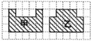

# Mathematics (Grade 6)

**ID**: 50ebc767
**难度**: medium
**题型**: multiple_choice

## 题目
如下图，甲的周长与乙的周长相比，（    ）．

A．甲＞乙
B．甲＜乙
C．甲＝乙

## 解答

**答案**: A

1. Step1:观察图形，甲和乙图形的水平方向的边长，甲的水平方向边长总和与乙的水平方向边长总和相等。
2. Step2:观察图形，甲和乙图形的垂直方向的边长，甲的垂直方向边长总和与乙的垂直方向边长总和相等。
3. Step3:因为图形的周长是各边长度之和，且甲和乙水平、垂直方向边长总和都分别相等，所以甲的周长与乙的周长相比，甲＞乙，答案选A。

## 知识点

**知识点**:
  - 小学数学;图形与几何;平面图形;组合图形的周长

---
