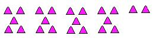

# Mathematics (Grade 6)

**ID**: 51cf8659
**难度**: medium
**题型**: multiple_choice

## 题目
看图数数，正确的是（ ） 

A．11
B．22
C．33
D．44

## 解答

**答案**: B

1. Step1:观察图片，逐行数出三角形的数量，第一行有5个三角形，第二行有4个三角形，第三行有5个三角形，第四行有4个三角形，第五行有4个三角形。
2. Step2:将每行三角形的数量相加，即5 + 4 + 5 + 4 + 4 = 22。
3. Step3:对比选项，发现22对应的是选项B。

## 知识点

**知识点**:
  - 小学数学;数与代数;数的认识;整数的认识

---
