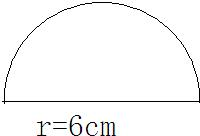

# Mathematics (Grade 6)

**ID**: 5341e47c
**难度**: medium
**题型**: multiple_choice

## 题目
如图所示，半圆的周长是（  ）
A．18.84cm
B．30.84cm
C．56.52cm$^{2}$

## 解答

**答案**: B

1. Step1:根据圆的周长公式c = 2πr，其中r = 6cm，π取3.14，先计算圆周长的一半，即2×3.14×6÷2 = 18.84cm
2. Step2:因为直径d = 2r，r = 6cm，所以直径为2×6 = 12cm
3. Step3:半圆的周长是圆周长的一半加上直径，所以半圆周长为18.84 + 12 = 30.84cm
4. Step4:对比选项，得出答案为B

## 知识点

**知识点**:
  - 圆、圆环的周长．

---
