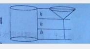

# Mathematics (Grade 6)

**ID**: 5350dbeb
**难度**: medium
**题型**: multiple_choice

## 题目
如右图：圆柱形烧杯与圆锥形杯子的底面积相等，将圆柱形烧杯装满水倒入圆锥形杯子，能装满(    )杯

 h h h

## 解答

**答案**: 9

1. Step1:明确圆柱体积公式为V柱 = S×h柱（S为底面积，h柱为圆柱的高），圆锥体积公式为V锥 = 1/3×S×h锥（S为底面积，h锥为圆锥的高）
2. Step2:由图可知圆柱形烧杯的高是圆锥形杯子高的3倍，设圆锥的高为h，则圆柱的高为3h，且它们底面积相等设为S
3. Step3:计算圆柱体积V柱 = S×3h = 3Sh，圆锥体积V锥 = 1/3×S×h = 1/3Sh
4. Step4:求能装满的杯数，用圆柱体积除以圆锥体积，即(3Sh)÷(1/3Sh) = 9

## 知识点

**知识点**:
  - 

---
