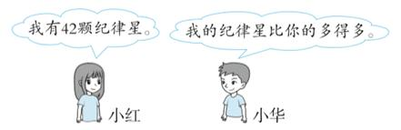

# Mathematics (Grade 6)

**ID**: 554fee88
**难度**: medium
**题型**: multiple_choice

## 题目
小华可能有多少颗纪律星？（   ）

A．32颗
B．50颗
C．93颗

## 解答

**答案**: C

1. Step1:分析选项A，32颗比42颗少，不符合小华的纪律星比小红多得多的条件
2. Step2:分析选项B，50颗比42颗多一些，不是多得多，不符合条件
3. Step3:分析选项C，93颗比42颗多很多，符合多得多的条件，所以答案是C

## 知识点

**知识点**:
  - 小学数学;数与代数;数的认识;整数的认识;100以内数的认识;数的相对大小关系

---
