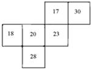

# Mathematics (Grade 6)

**ID**: 55c135b1
**难度**: medium
**题型**: multiple_choice

## 题目
如图是一个正方体的展开图，在原正方体中，两个相对的面上两数之和最大是（  ）
A．45
B．48
C．50
D．58

## 解答

**答案**: C

1. Step1:根据正方体展开图相对的面相隔一个面的规律，找出18和23相对
2. Step2:计算18与23的和，即18+23=41
3. Step3:找出20和30相对
4. Step4:计算20与30的和，即20+30=50
5. Step5:找出17和28相对
6. Step6:计算17与28的和，即17+28=45
7. Step7:比较41、50、45的大小，得出50最大

## 知识点

**知识点**:
  - 正方体的特征．

---
