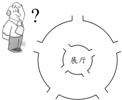

# Mathematics (Grade 6)

**ID**: 5796a1e2
**难度**: medium
**题型**: multiple_choice

## 题目
一个圆形科技展览馆，馆的周围有5个门，展厅有4个小门，A先生从馆外进入展厅，可以有（  ）种不同的走法．
A．9
B．8
C．20

## 解答

**答案**: C

1. Step1:明确从馆外进入展览馆有5个门，即有5种不同的进入方法
2. Step2:明确进入展厅有4个小门，即进入展厅有4种不同的方法
3. Step3:根据乘法原理，将进入展览馆的方法数与进入展厅的方法数相乘，得到不同走法的总数为5×4=20种
4. Step4:对比选项，答案为C

## 知识点

**知识点**:
  - 乘法原理．

---
