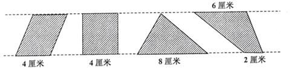

# Mathematics (Grade 6)

**ID**: 584fe549
**难度**: medium
**题型**: multiple_choice

## 题目
下面图形中，有（   ）个图形面积相等。

$\begin{description}
\item A．2\item B．3\item C．4
\end{description}$

## 解答

**答案**: C

1. Step1:设高为h，根据平行四边形面积公式S = 底×高，第一个平行四边形面积为4h。
2. Step2:根据长方形面积公式S = 长×宽，第二个长方形面积为4h。
3. Step3:根据三角形面积公式S = 底×高÷2，第三个三角形面积为8h÷2 = 4h。
4. Step4:根据梯形面积公式S=(上底 + 下底)×高÷2，第四个梯形面积为(2 + 6)h÷2 = 4h。
5. Step5:比较四个图形面积，发现它们都为4h，所以面积相等的图形有4个。

## 知识点

**知识点**:
  - 

---
