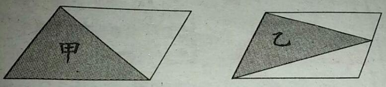

# Mathematics (Grade 6)

**ID**: 5b94f2c4
**难度**: medium
**题型**: multiple_choice

## 题目
下面两个平行四边形的面积相等，比较图中阴影部分的面积：甲(     )
  乙.
  A.等于
  B.小于
  C.大于

## 解答

**答案**: A

1. Step1:明确已知条件为两个平行四边形面积相等
2. Step2:根据平行四边形和三角形面积关系，得出每个阴影部分三角形面积都等于其所在平行四边形面积的一半
3. Step3:因为两个平行四边形面积相等，所以它们各自一半的面积也相等，即甲的面积等于乙的面积
4. Step4:根据选项，选择答案A

## 知识点

**知识点**:
  - --

---
