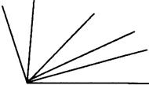

# Mathematics (Grade 6)

**ID**: 5d9d164b
**难度**: medium
**题型**: multiple_choice

## 题目
如图中共有（  ）个角．

A．6
B．15
C．21

## 解答

**答案**: B

1. Step1:观察图形可知图中共有6条共端点的射线
2. Step2:根据角的构成原理，最上边第一条射线与其它5条射线组成5个角
3. Step3:第二条射线与下边4条射线组成4个角
4. Step4:第三条射线与下边3条射线组成3个角
5. Step5:第四条射线与下边2条射线组成2个角
6. Step6:第五条射线与下边1条射线组成1个角
7. Step7:计算角的总数为5+4+3+2+1=15个
8. Step8:对比选项，答案为B

## 知识点

**知识点**:
  - 组合图形的计数．

---
