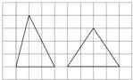

# Mathematics (Grade 6)

**ID**: 5dfe6129
**难度**: medium
**题型**: multiple_choice

## 题目
观察如图两个三角形，说法正确的是（  ）

A．周长相等
B．面积相等
C．周长、面积都不相等

## 解答

**答案**: B

1. Step1:观察图形，确定右边三角形的底是4个格，高是3个格
2. Step2:根据三角形面积公式“三角形的面积=底×高÷2”，计算右边三角形面积为4×3÷2=6
3. Step3:观察图形，确定左边三角形的底是3个格，高是4个格
4. Step4:根据三角形面积公式“三角形的面积=底×高÷2”，计算左边三角形面积为3×4÷2=6
5. Step5:比较两个三角形面积，发现都为6，所以面积相等，得出答案选B

## 知识点

**知识点**:
  - 三角形的周长和面积．

---
