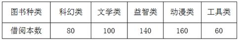

# Mathematics (Grade 6)

**ID**: 5ed8c764
**难度**: medium
**题型**: multiple_choice

## 题目
少儿图书馆一天的图书借阅情况如下：

用条形图表示上面的数据，1格代表(  )本较合适。
$\begin{description}
\item A．10\item B．20\item C．30\item D．50
\end{description}$

## 解答

**答案**: B

1. Step1:观察题目所给的借阅本数，分别为80、100、140、160、60。
2. Step2:分析选项A，若1格代表10本，绘制条形图时，格数较多，图形会较长，不太简洁。
3. Step3:分析选项B，若1格代表20本，80÷20 = 4格，100÷20 = 5格，140÷20 = 7格，160÷20 = 8格，60÷20 = 3格，绘制出的条形图格数适中，能较好地展示数据。
4. Step4:分析选项C，若1格代表30本，80÷30≈2.67格，100÷30≈3.33格，140÷30≈4.67格，160÷30≈5.33格，60÷30 = 2格，格数不是整数，绘制条形图不方便。
5. Step5:分析选项D，若1格代表50本，80÷50 = 1.6格，100÷50 = 2格，140÷50 = 2.8格，160÷50 = 3.2格，60÷50 = 1.2格，格数不是整数，绘制条形图不方便，且不能很好地展示数据细节。
6. Step6:综合比较，1格代表20本较合适，答案选B。

## 知识点

**知识点**:
  - 小学数学;统计和概率;统计;统计图;简单条形统计图

---
